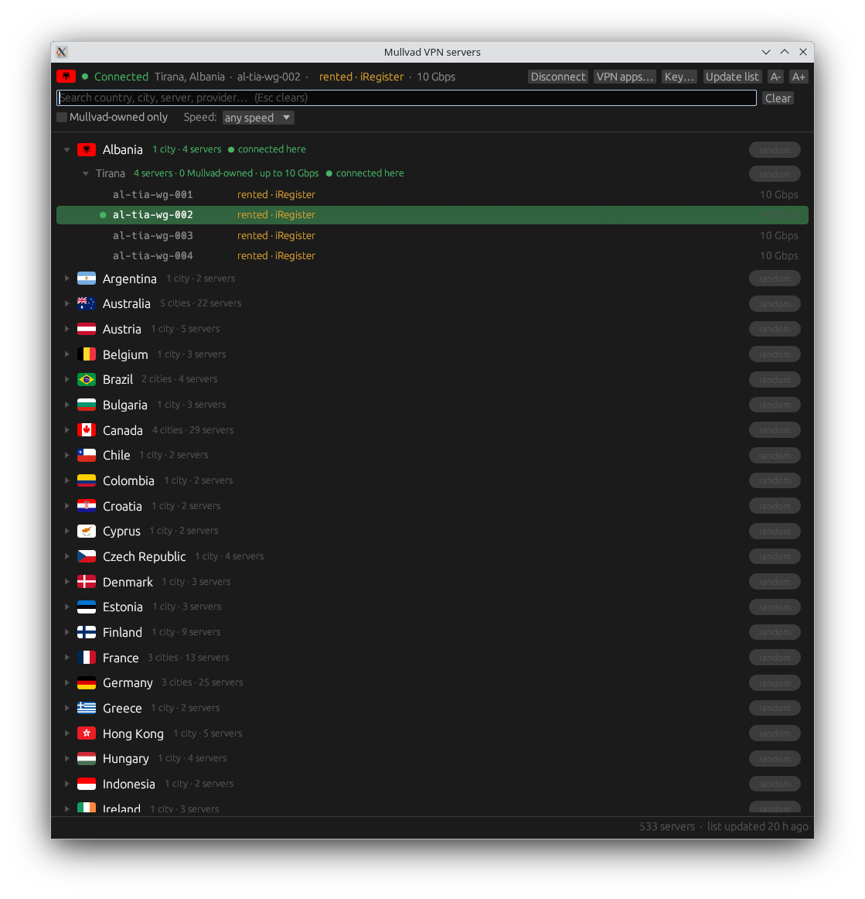
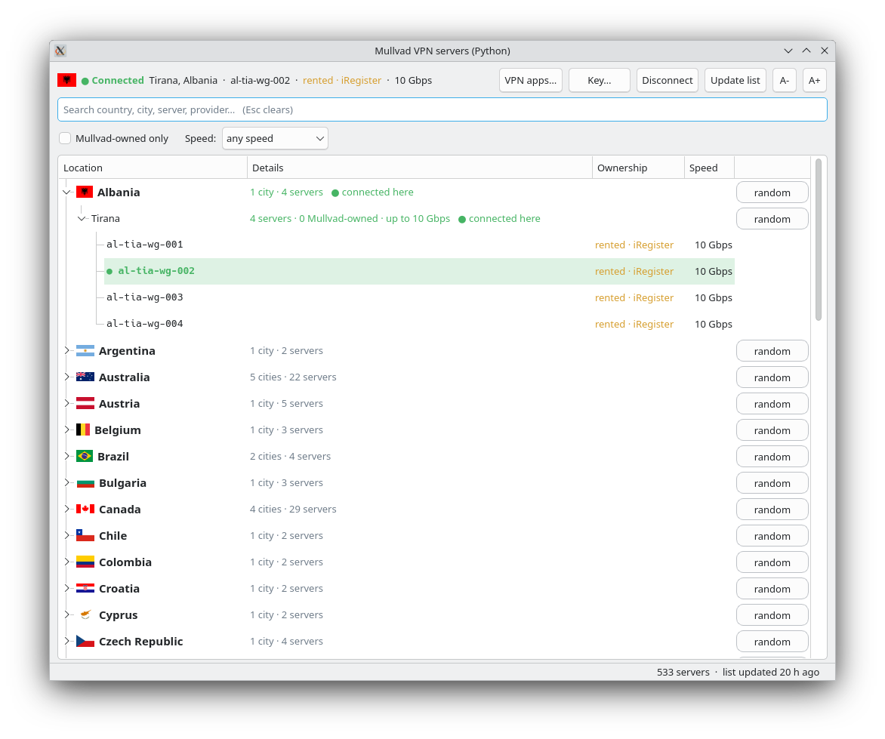
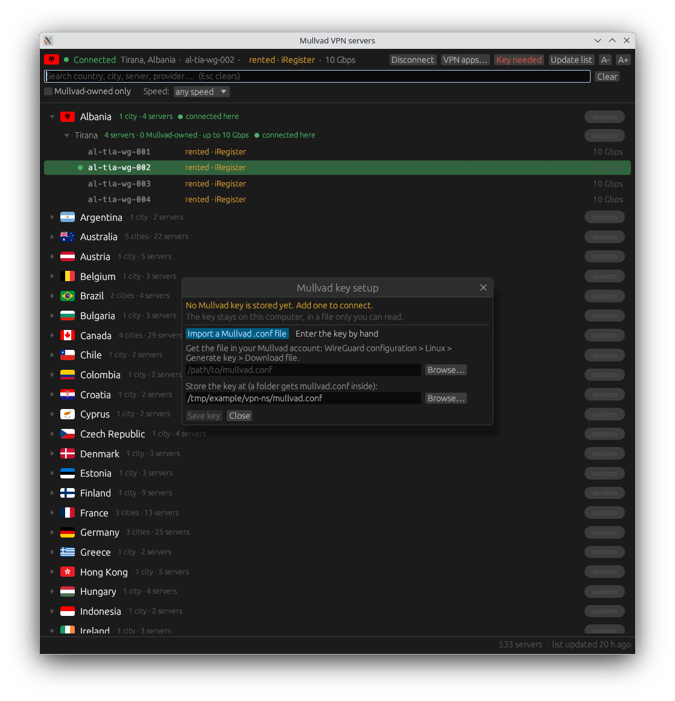
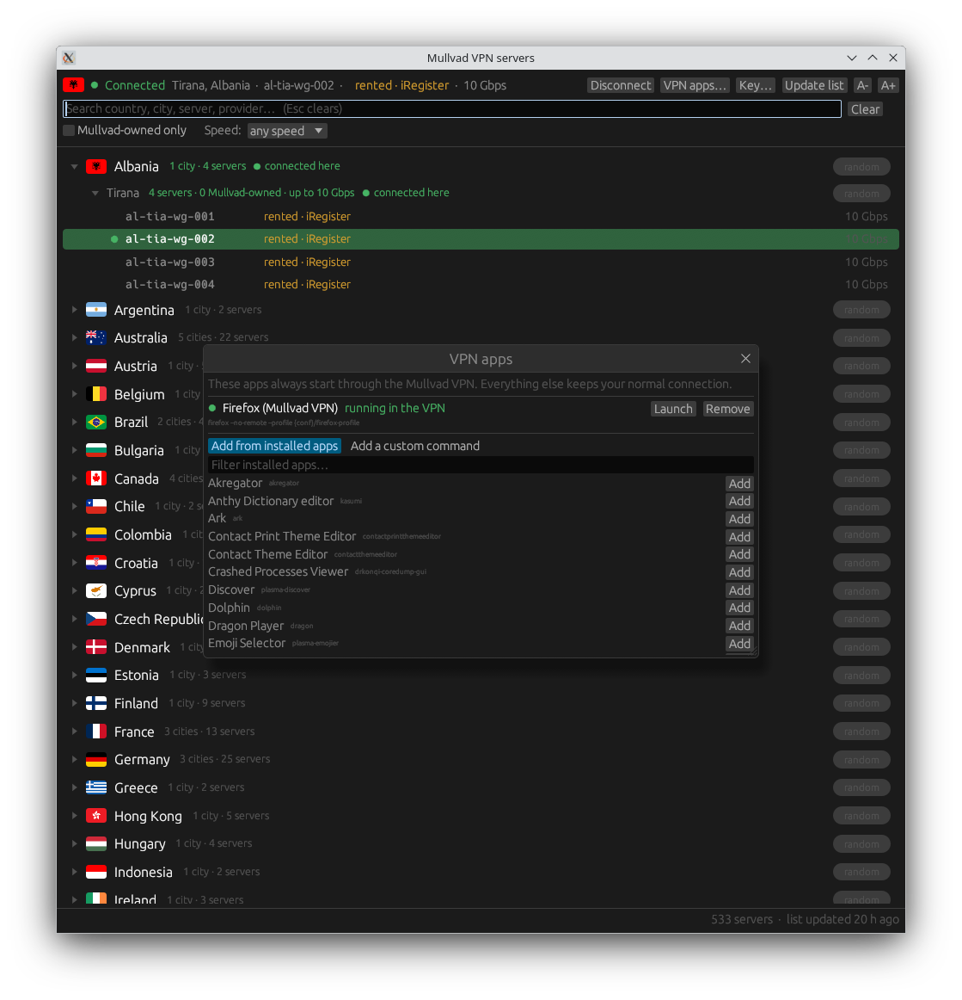

# mullvad-per-app-vpn

**Use your Mullvad VPN for only the apps you choose, and keep everything else on your normal connection. Switch the country, city or server with one click, without restarting the app.**

> Unofficial community project. Not affiliated with, endorsed by or supported by Mullvad VPN AB. "Mullvad" is their trademark. You need your own Mullvad account.

| Rust window | Python window |
|---|---|
|  |  |

## Why this exists

The official Mullvad app routes your whole computer through the VPN. Its Linux split tunneling only works the other way round: you *exclude* apps from the VPN. If you want the opposite (only a browser on the VPN, while your work tools, servers, SSH sessions, LAN devices and other VPNs stay untouched), you end up excluding every other app by hand.

That is the use case here. A typical example: Firefox goes through Mullvad, Chrome and your command-line tools keep your real connection, so that sites that dislike VPN addresses (logins, banks, shops) only ever see your VPN when you decide.

## How it works

```
 your computer (normal network)                    network namespace "vpn"
 ┌──────────────────────────────┐                 ┌──────────────────────────┐
 │ Chrome, terminal, Docker,    │                 │  Firefox (VPN profile)   │
 │ other VPNs, everything else  │                 │  only sees: lo + wgvpn   │
 │            │                 │                 │            │             │
 │       normal route           │                 │   default route: wgvpn   │
 │            ▼                 │                 │            ▼             │
 │         internet             │                 │  WireGuard ──────────────┼──► Mullvad server
 └──────────────────────────────┘                 └──────────────────────────┘
```

- A Linux **network namespace** called `vpn` contains only a loopback interface and one WireGuard interface (`wgvpn`). Apps started inside it have no other way out.
- The WireGuard socket is created in your normal namespace and then moved into `vpn`, so the encrypted traffic itself leaves through your normal connection.
- **Kill switch by design:** if the tunnel is down, VPN apps have no route at all. Nothing leaks to your real IP. IPv6 is disabled inside the namespace.
- **Live switching:** changing country/city/server only swaps the WireGuard peer inside the namespace. The app keeps running; its connections reconnect through the new exit.
- **One key for all servers.** A Mullvad WireGuard key works on every server; the program just picks the endpoint from Mullvad's public server list.
- Nothing global is changed: no routes, DNS or firewall rules of your normal network are touched, and no other interface is modified.

Two windows, same features, same engine (the `vpn-ns` script):

- **Rust** (`vpn-ns-gui`): one small native binary, starts instantly.
- **Python/Qt6** (`vpn-ns-qt`): no compiling, easy to read and change, needs `python3-pyqt6`.

## Features

- Country > city > server tree with **flags**, live **search**, one click to connect, "random" button per country/city.
- Per server: **Mullvad-owned or rented**, hosting provider and **port speed in Gbps**. Filters for "Mullvad-owned only" and a minimum speed.
- Shows the server you are really connected to (read from the live tunnel), a **Disconnect** button, and an **Update list** button (the list is also refreshed daily).
- **Key setup in the window:** checked at every start; import the `.conf` Mullvad gives you, or type the key; stored with permissions `600` in a folder you choose; replace or delete it anytime.
- **VPN apps list in the window:** add apps from your installed programs or with a custom command, remove them, launch them. Each app gets a menu entry. Browsers get their own profile automatically so they are not merged with a browser instance that is open outside the VPN.

| Key setup | VPN apps |
|---|---|
|  |  |

## Install

Requirements: Linux with network-namespace and WireGuard kernel support (any current distribution), `ip` (iproute2), `wg` (wireguard-tools), `python3`, `curl`, `setpriv`, `sudo`. Optional: `python3-pyqt6` for the Python window, `kdialog` or `zenity` for the Browse buttons.

Tested on **Debian 13, KDE Plasma, X11, x86_64**. Other setups are untested (see Limitations).

**Quick install** (downloads the latest release, verifies its SHA-256 checksum, installs into your home directory):

```bash
curl -fsSL https://raw.githubusercontent.com/sirdree/mullvad-per-app-vpn/main/install.sh | bash
```

If you prefer to read before you run (recommended for any `curl | bash`):

```bash
curl -fsSL -o install.sh https://raw.githubusercontent.com/sirdree/mullvad-per-app-vpn/main/install.sh
less install.sh
bash install.sh
```

**From source** (no binary download; the Python window needs no build at all):

```bash
git clone https://github.com/sirdree/mullvad-per-app-vpn.git
cd mullvad-per-app-vpn
./install.sh                 # engine + Python window
./install.sh --build-rust    # also builds the Rust window (needs cargo, a few minutes)
```

The installer asks before it creates one file outside your home directory: `/etc/sudoers.d/mullvad-per-app-vpn` (see Security notes). Options: `--sudoers`, `--no-sudoers`, `--no-launchers`, `--yes`, `--version vX.Y.Z`. Remove everything with `./install.sh --uninstall` (add `--purge` to delete your stored key too).

The prebuilt Rust binary is built on Debian 13 (glibc 2.39 or newer). On an older system the installer detects that, skips it and you can use the Python window or `--build-rust`.

## First use

1. Open **Mullvad VPN** from your application menu (there is a Rust and a Python entry), or run `vpn-ns-qt`.
2. The window asks for your key. In your Mullvad account open **WireGuard configuration**, choose **Linux**, generate a key, and download the `.conf` file. Import it with the Browse button (or enter the key by hand). The window shows where the key is stored.
3. Click a server (or press Enter when the search narrows to one). The status line shows the connection.
4. Start **Firefox (Mullvad VPN)** from the menu. Only apps started like this use the VPN. Add more under **VPN apps…**.
5. Change country any time by clicking another server. **Disconnect** turns the VPN off (VPN apps that are still open lose their connection and must be restarted).

Check it: open `https://mullvad.net/check` in the VPN app and in your normal browser. They should show different addresses.

Mullvad allows a limited number of devices per account; this program uses one of them (the key you generated).

## Command line

Everything the windows do is done by the `vpn-ns` script, so you can use it directly:

```bash
vpn-ns key status          # is a valid key stored?
vpn-ns key import file.conf
vpn-ns up de               # connect (country code, "de-fra" city, or a server like de-fra-wg-101)
vpn-ns switch se-sto       # switch live
vpn-ns list de             # list servers
vpn-ns current             # server you are connected to
vpn-ns run curl https://am.i.mullvad.net/json   # run any command through the VPN
vpn-ns apps list|add|remove
vpn-ns down                # disconnect ('down force' even if apps still run in it)
```

Settings live in `~/.config/vpn-ns/` (`mullvad.conf` = your key, `apps.conf` = the VPN apps, `servers.json` = cached public server list).

## Security notes

- **Your private key stays on your computer**, in a file readable only by you, and is never put on a command line (so it does not show up in process lists) and never printed by the program. Do not post `.conf` files or screenshots of them anywhere.
- **sudoers:** creating a namespace and a WireGuard interface needs root, and a GUI cannot type a password. The optional sudoers file lets your user run exactly these commands without a password: `ip netns *`, `ip link add wgvpn type wireguard`, `ip link set wgvpn netns vpn`, `mkdir -p /etc/netns/vpn`, `tee /etc/netns/vpn/resolv.conf`. **Be aware:** `ip netns exec` can run any program as root, so this is effectively passwordless root for your user. If that is not acceptable on your machine, skip it (`--no-sudoers`) and run the `vpn-ns` commands from a terminal where sudo can ask for a password.
- Apps in the VPN run as **you**, with all capabilities dropped (`setpriv`), not as root.
- DNS inside the namespace uses the Mullvad in-tunnel resolver given in your `.conf`.
- Only apps started through this program are in the VPN. A browser that is already open outside the VPN is not moved into it: that is why the VPN browser profile is separate (it also keeps cookies and logins separate, which is usually what you want).
- Kill switch only covers the VPN apps (by design). It is not a system-wide kill switch.

## Limitations

- One namespace means all VPN apps share the same exit at the same time.
- IPv4 only, single hop, WireGuard port 51820 by default (`VPN_NS_PORT=...` to change). No multihop, no OpenVPN, no DAITA/quantum-resistant tunnels.
- Tested on X11 only. The Rust window is built for X11. Wayland-only apps are not passed their Wayland socket yet.
- The prebuilt binary is x86_64 only; other architectures build from source.
- The server list comes from Mullvad's public website API (`https://api.mullvad.net/www/relays/wireguard/`). It is not a documented, stable API and could change; then "Update list" will fail until the program is adjusted. The list is cached, so everything keeps working with the last good copy.

## Uninstall

```bash
bash ~/.local/share/mullvad-per-app-vpn/install.sh --uninstall           # the installer keeps a copy here
curl -fsSL https://raw.githubusercontent.com/sirdree/mullvad-per-app-vpn/main/install.sh | bash -s -- --uninstall
```

Remove the device (key) from your Mullvad account page if you no longer need it.

## Development

```bash
cd rust && CARGO_RESOLVER_INCOMPATIBLE_RUST_VERSIONS=fallback cargo build --release   # Rust window
python3 vpn-ns-qt                                                                       # Python window
tools/make-release.sh                                                                   # release bundle in dist/
```

The windows are only front ends: all VPN logic is in the `vpn-ns` bash script (with small embedded Python helpers). Test overrides: `VPN_NS_CONF_DIR`, `VPN_NS_DESKTOP_DIR`, `VPN_NS_NO_APPLY=1`.

## Credits and licenses

- MIT licensed, see [LICENSE](LICENSE).
- Server data: Mullvad's public server list. This project is not affiliated with Mullvad.
- Flag images: [Flagpedia](https://flagpedia.net) (free to use).
- Rust window built with [egui/eframe](https://github.com/emilk/egui) (MIT/Apache-2.0). Python window uses PyQt6, installed separately from your distribution.
